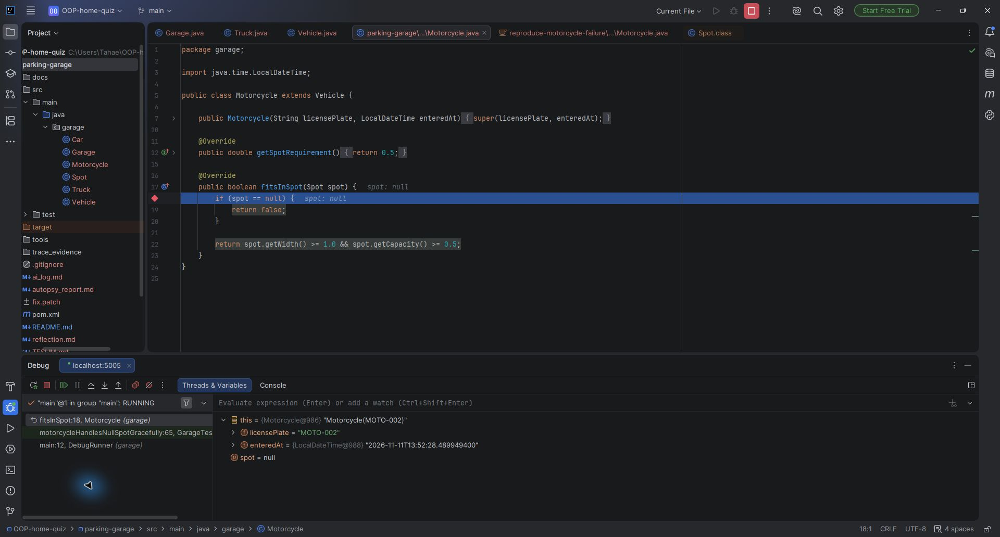
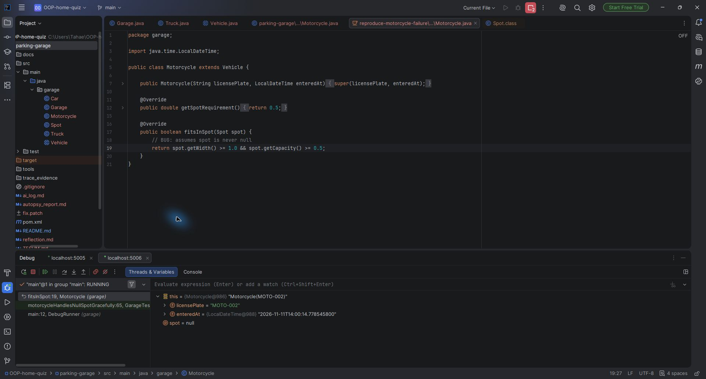

# Trace Evidence

The text records in this directory are actual command output. Capture times use Turkey time. The source used to reproduce the old failure is kept separate from the current source.

## File guide

| File or directory | Contents |
|---|---|
| `capture_manifest.json` | Baseline commit, capture time, and supplied-test SHA-256 |
| `verification.json` | Test integrity and patch-application checks |
| `snapshots/repository-original/` | Git HEAD sources placed in the documented Maven layout |
| `snapshots/before-final-review/` | Exact source state before the final Garage changes |
| `snapshots/reproduce-motorcycle-failure/` | Buildable reproduction of the old motorcycle failure |
| `logs/01-original-compile.txt` | Original Truck constructor compilation failure |
| `logs/02-before-final-review-tests.txt` | Maven result before the final review changes |
| `logs/03-final-tests.txt` | Final Maven result: 7 tests, 1 failure, 0 errors |
| `logs/scenarios-before.txt` | Additional checks: 6 passed, 2 failed |
| `logs/scenarios-after.txt` | Additional checks: 8 passed, 0 failed |
| `logs/scenarios-reproduction.txt` | Additional checks on the buildable old copy: 3 passed, 5 failed |
| `debugger/motorcycle-reproduction.txt` | Null argument and actual NPE in the old method |
| `debugger/motorcycle-current.txt` | Null argument handled by returning false |
| `debugger/truck-current.txt` | Non-null entry time and the failing assertThrows assertion |
| `screenshots/` | Unedited IDE debugger captures, described below |

## Repeating the checks

Run these commands from the project root. Java 17+, the JDK's `jdb`, Maven, and Python 3.10+ are required. The Python helpers use only the standard library.

```powershell
mvn --batch-mode --no-transfer-progress test
python tools/collect_evidence.py scenarios-after
python tools/collect_evidence.py compile-debug
python tools/capture_debugger.py
python tools/build_patch.py
```

The `prepare` operation creates the initial snapshot and refuses to overwrite an existing one. It is not needed when reviewing the prepared submission. Other commands regenerate their corresponding records; timestamps and object identifiers will differ between runs.

`DebugRunner` creates the supplied test class in the same package, calls `setUp()`, and runs the selected test method. It does not change `GarageTest.java`. `GarageScenarioChecks` is separate from the supplied JUnit suite.

## Following the trace manually

After compiling the debugger sources, run this in PowerShell:

```powershell
$debugClasspath = Get-Content target/evidence/current-classpath.txt -Raw
jdb -classpath $debugClasspath -sourcepath "src/main/java;src/test/java;tools" garage.DebugRunner motorcycle
```

Then enter these debugger commands:

```text
stop in garage.Motorcycle.fitsInSpot
run
where
locals
print spot
dump this
next
```

For Truck, use `garage.DebugRunner truck`. Set `stop at garage.Vehicle:35` to inspect `enteredAt` before fee calculation.

## IDE screenshots

The screenshots were taken in IDE sessions separate from the jdb transcripts. Timestamps and object identifiers may therefore differ. Each image must be read with its source version, line number, and displayed values. The captures have not been edited or translated.

### Current Motorcycle — null check

Paused at src/main/java/garage/Motorcycle.java:18. The variables show spot = null, licensePlate = MOTO-002, and an initialized enteredAt. This capture uses the corrected source.



### Motorcycle — reproduction of the old failure

The source shown is Motorcycle.java:19 under trace_evidence/snapshots/reproduce-motorcycle-failure. The old code calls getWidth while spot is null. This session is separate from the corrected-source session. The reproduction source was opened manually while paused at the method breakpoint with the fitsInSpot:19 frame selected; the Variables panel contains values from the running old version.


